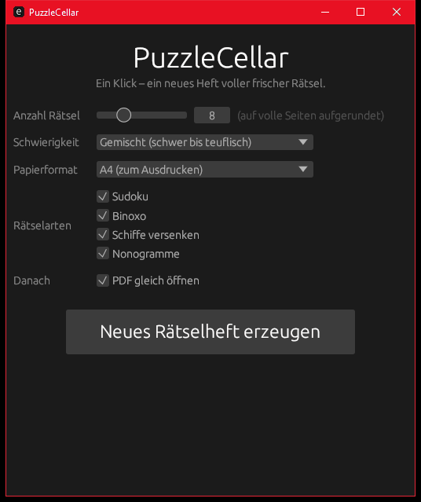
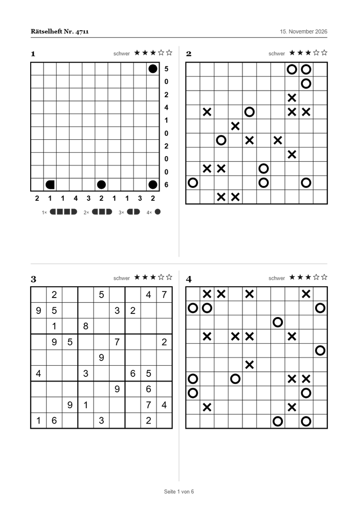
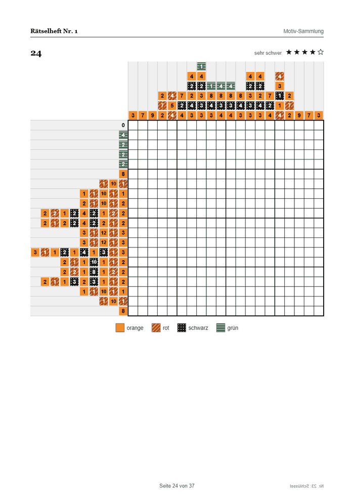

<p align="center"></p>

<h1 align="center">PuzzleCellar</h1>

**One click, one fresh puzzle booklet.** PuzzleCellar is a small Windows desktop app written in Rust that generates printable puzzle booklets as PDF – Sudoku, Binoxo (Takuzu), Battleships (Bimaru) and Nonograms (Picross) – every puzzle new, randomly generated and guaranteed to have exactly one solution.

It is made for people who like their puzzles *hard* and on paper: the difficulty of every puzzle is rated by a human-style solver (which solving techniques are needed?), not by counting clues.

<p align="center">
  
</p>

<p align="center">
  
  
</p>

> The user interface and the booklets are in **German** (e.g. *schwer* = hard, *sehr schwer* = very hard, *teuflisch* = fiendish).

## Features

- **Four puzzle types**, mixed into one varied booklet (or pick the ones you like):
  - **Sudoku** 9×9 – rated by techniques from singles up to X-Wing, Swordfish, Jellyfish, XY- and XYZ-Wing; *fiendish* means even those are not enough.
  - **Binoxo** 10×10 or 12×12 with X and O – no three in a row, balanced lines, no duplicate rows or columns.
  - **Battleships** – classic 10×10 fleet, a variant with missing edge numbers, and a 12×12 variant with a bigger fleet.
  - **Nonograms** 15×15 up to 25×25, black-and-white **and colour**, from a hand-drawn motif collection (37 motifs, each optionally mirrored).
- **Three difficulty levels** – hard, very hard, fiendish – mixed, ascending, or a single level.
- **Unique solutions only.** Every puzzle is checked by a solver; nonogram motifs that logic alone cannot resolve get a few pre-filled cells.
- **Print-friendly layout**: four small puzzles per page, one nonogram per page, pages are filled up completely.
- **Two paper formats**: A4 for home printing and **170 × 240 mm** (book/magazine format) for print shops.
- **No spoilers**: nonogram answers are only the motif name, printed small, grey and **mirror-inverted** in the footer of the *next* page.
- **Colour nonograms work in black and white**: every colour also has its own pattern (hatching, dots, stripes …) and the legend names the colours.
- **Fast**: a whole booklet takes a few seconds at most; booklets are reproducible from their number.

## Getting started

PuzzleCellar is built from source (Windows).

1. Install Rust: <https://rustup.rs>. The project is developed with the lightweight **GNU toolchain** (`x86_64-pc-windows-gnu`, no Visual Studio needed); the MSVC toolchain has not been tested.
2. Clone the repository and double-click **`bauen.bat`** (“build”). It compiles a release build, puts **`PuzzleCellar.exe`** into the project folder and stamps the app icon into it (`examples/icon_einsetzen.rs` uses the Windows `UpdateResource` API, since the GNU toolchain has no resource compiler).
3. Start `PuzzleCellar.exe`, press **“Neues Rätselheft erzeugen”** (“create new booklet”). The PDF is saved to `Documents\Rätselhefte` and opened right away.

Fonts (Arial, Georgia) are taken from `C:\Windows\Fonts` at runtime and embedded into the PDF; they are not part of this repository.

### Notes on the GNU toolchain

The minimal GNU toolchain ships without a working `dlltool`, so crates that use `raw-dylib` / `windows-link` cannot be built with it. That is why a few dependency versions are pinned in `Cargo.lock` (see `PLAN.md`) – **please don't run a blanket `cargo update`**. `link-gnu/libshlwapi.a` provides a missing import library (taken from the [`winapi-x86_64-pc-windows-gnu`](https://crates.io/crates/winapi-x86_64-pc-windows-gnu) crate, MIT/Apache-2.0); `build.rs` adds it to the linker search path.

The window uses `eframe`/`egui` with the **wgpu** renderer (DirectX 12) – the OpenGL backend showed a blank window on some AMD drivers.

## Adding your own nonogram motifs

All motifs live in [`src/raetsel/motive.txt`](src/raetsel/motive.txt) as plain text pixel art – append a block and rebuild:

```text
=== Strawberry
farben: r=D7263D g=2E8B57 y=E8B923
.......g.......
....g..g..g....
.....ggggg.....
...ggrrrrrgg...
...
```

`.` is empty, `#` is black for black-and-white motifs, otherwise the letters from the `farben:` (colours) line. Width and height must be between 15 and 25. The test suite checks every motif for a unique, logically solvable solution and decides its difficulty automatically. Preview the whole collection with:

```bash
cargo run --release --example motive
```

## Development

```bash
cargo test --release --lib                        # uniqueness, ratings, solver correctness
cargo run --release --example testheft            # sample booklet → target/testheft.pdf
cargo run --release --example testheft -- --buch  # same in 170 × 240 mm
```

| Path | Contents |
|---|---|
| `src/raetsel/` | generators and human-style solvers: `sudoku.rs`, `binoxo.rs`, `schiffe.rs` (Battleships), `nonogramm.rs`, `motive.txt` |
| `src/heft.rs` | booklet planning (types, difficulty mix, page filling), parallel generation |
| `src/pdf/` | PDF layout and drawing (`printpdf`) |
| `src/app.rs` | the window (`egui`) |
| `PLAN.md` | design decisions and roadmap (German) |

The code and comments are in German.

## License

[MIT](LICENSE) © 2026 targetonline-at
